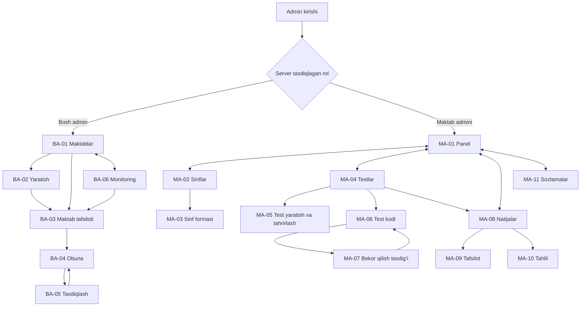
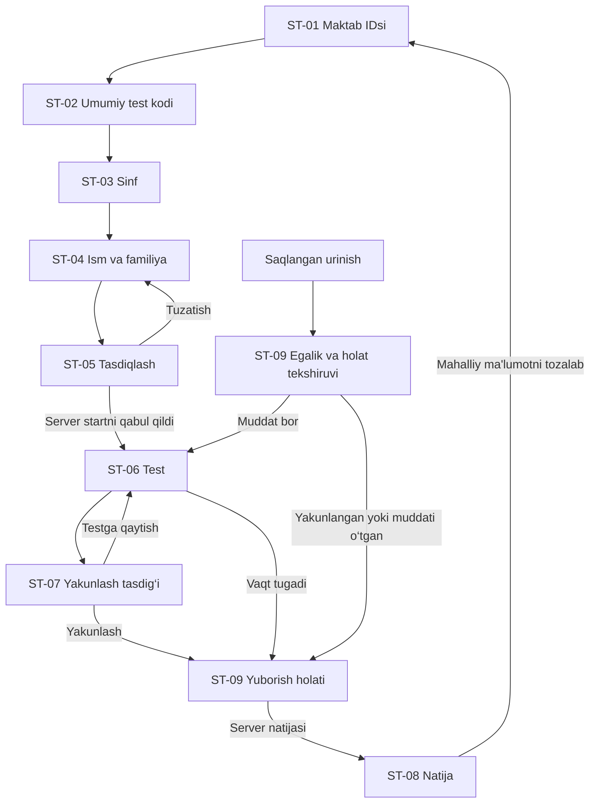

# 1.6-bosqich: rollar bo‘yicha ekranlar loyihasi

Sana: 2026-10-31. Holat: tahlil va loyiha talablari; interfeysga tatbiq etilmagan.

Asoslar: [roles.md](roles.md), [school-id.md](school-id.md), [student-access.md](student-access.md), [test-code.md](test-code.md), [student-flow.md](student-flow.md). Shaxsiy o‘quvchi kodi, login, parol yoki profil yaratilmaydi. Ekran mantiqiy sahifa yoki modal bo‘lishi mumkin; quyidagi ekran IDlari URL yoki mavjud API nomi emas.

## 1. Mavjud HTML, JavaScript va CSS tahlili

| Mavjud sahifa / komponent | Amaldagi vazifasi va JS | Maqsadli ekranga mosligi |
| --- | --- | --- |
| `/oqituvchi/kirish.html` | [login.js](../../public/js/teacher/login.js): umumiy admin paroli va sessiyasi | Admin kirishi qisman bor; bosh admin/maktab admini hisoblari va rol ajratilishi yo‘q |
| `/oqituvchi/index.html` | [dashboard.js](../../public/js/teacher/dashboard.js): bugungi topshirishlar, faol testlar, sinflar, o‘rtacha natija | Maktab paneliga asos bor; hozir maktab bo‘yicha server izolyatsiyasi yo‘q |
| `/oqituvchi/sinflar.html` | [classes.js](../../public/js/teacher/classes.js), [class-editor.js](../../public/js/teacher/class-editor.js): sinf kartalari, roster modal, progress va shaxsiy kodlar | Sinflar qisman bor; shaxsiy kod amallari yangi talabga zid |
| `/oqituvchi/testlar.html` | [tests.js](../../public/js/teacher/tests.js): qidiruv/holat, tahrir, nusxa, faollik, Aiken eksport/o‘chirish | Testlar ro‘yxati mavjud; test kodi holati alohida kerak |
| `/oqituvchi/test-tahrir.html` | [test-editor.js](../../public/js/teacher/test-editor.js), [test-form-view.js](../../public/js/teacher/test-form-view.js): sinf, vaqt, jadval, Aiken va savollar | Test yaratish/tahrirlash mavjud; maktab chegarasi va akkauntsiz urinish limiti talablari kerak |
| `/oqituvchi/natijalar.html` | [results.js](../../public/js/teacher/results.js), [result-detail.js](../../public/js/teacher/result-detail.js), [analytics.js](../../public/js/teacher/analytics.js): filtr/jadval, CSV/XLS/chop, tafsilot va tahlil modallari | Hisobotlar mavjud; maktab doirasi hamda ismdoshlar siyosati yetishmaydi |
| `/oqituvchi/sozlamalar.html` | [settings.js](../../public/js/teacher/settings.js): parol, zaxira, tiklash, umumiy tozalash | Mavjud qo‘shimcha ekran; umumiy tozalash vakolati maktab adminiga avtomatik berilmaydi |
| `/teacher.html` | Eski admin kirish havolasi uchun moslik sahifasi | Yangi bosh admin paneli emas; moslik saqlanishi kerak |
| `/index.html` | [home.js](../../public/js/student/home.js): sinf → shaxsiy kod yoki ism → test | Maktab IDsi, umumiy test kodi va tasdiqlash ekranlari yo‘q; tartib yangi talabga mos emas |
| `/test.html` | [test.js](../../public/js/student/test.js), timer, xarita, draft, submission | Test runner bor; kod/obuna tugagandagi davom ettirish talabi hali to‘liq bajarilmagan |
| `/natija.html` | [result.js](../../public/js/student/result.js): ball, foiz, savol holati va ruxsatli sharh | Natija bor; yangi maktab konteksti va umumiy qurilmada tozalash oqimi kerak |
| Bosh admin sahifalari | Maktablar, yaratish/tahrirlash, obunalar, monitoring uchun HTML/JS aniqlanmadi | Barchasi yetishmaydi |
| Umumiy test kodi ekrani | Alohida HTML/JS aniqlanmadi; mavjud `student-codes.js` boshqa vazifada | Yetishmaydi; shaxsiy kod ekranini shunchaki qayta nomlash yetarli emas |

Umumiy UI: [shell.js](../../public/js/teacher/shell.js) sessiya, maktab belgisi, chiqish va yuklanishni; [sidebar.js](../../public/js/components/sidebar.js) 5 bo‘limni boshqaradi. `Maktab maydoni` yozuvi maktab egaligining serverda tekshirilgan dalili emas. [modal.js](../../public/js/components/modal.js) forma xatolarini modalda saqlaydi va yuborishda takror bosishni cheklaydi; umumiy skeleton, toast, jadval va bo‘sh holat komponentlari bor.

CSS kirishi [styles.css](../../public/css/styles.css); qatlamlar: tokens/base, komponentlar, layout va sahifalar. [responsive.css](../../public/css/pages/responsive.css) 1100 px, [mobile.css](../../public/css/pages/mobile.css) 760 px, [small-screen.css](../../public/css/pages/small-screen.css) 380 px chegaralarda joylashuvni o‘zgartiradi. Telefonda panel navigatsiyasi pastga ko‘chadi, formalar bitta ustunga tushadi; [content-fit.css](../../public/css/pages/content-fit.css) uzun matnlarni o‘raydi. Bu statik kod kuzatuvi; yangi ekranlar brauzerda tayyor deb hisoblanmaydi.

## 2. Umumiy ekran shartnomasi

Har ekran quyidagi holatlarga ega: **yuklanmoqda, tayyor, bo‘sh, xato, yuborilmoqda, muvaffaqiyat**. Bo‘sh ro‘yxat server xatosi sifatida ko‘rsatilmaydi. Xatoda qayta urinish tugmasi va kiritilgan ma'lumot saqlanadi; server tasdig‘isiz muvaffaqiyat xabari yo‘q. Takror bosish dublikat yozuv yaratmaydi.

Admin panel sarlavhasida rol ko‘rsatiladi; maktab adminida server tasdiqlagan maktab nomi va nusxalanadigan doimiy ID bo‘ladi. Rolga tegishli bo‘lmagan menyu yashiriladi, lekin asosiy ruxsat serverda tekshiriladi. Begona URL/ID bilan kirish ham himoyalanadi. O‘quvchi UI'sida admin ma'lumoti, roster, eski shaxsiy kodlar yoki javob kalitlari sizmaydi.

Umumiy xabarlar: `Ma'lumotlarni yuklab bo‘lmadi. Qayta urinib ko‘ring.`, `O‘zgarishlar saqlanmadi. Qayta urinib ko‘ring.`, `Sessiya tugagan. Qayta kiring.`, `Bu amalga ruxsat yo‘q.`, `So‘rovlar ko‘paydi. Ko‘rsatilgan vaqt tugagach qayta urinib ko‘ring.` Begona/topilmagan obyekt bir xil `Ma'lumot topilmadi yoki unga kirish mumkin emas.` xabari bilan yopiladi. Forma xatosi maydon yonida va umumiy xato blokida ko‘rsatiladi.

## 3. Admin kirish ekranlari

| Ekran | Vazifa / maydonlar | Tugmalar | Xato va chegaralar |
| --- | --- | --- | --- |
| AUTH-01: bosh admin kirishi | Bosh admin sessiyasini olish; hisob identifikatori zarurligi alohida auth qarori, parol, parolni ko‘rsatish/berkitish | `Kirish`, `Parolni ko‘rsatish` | Umumiy noto‘g‘ri kirish xabari, tezlik cheklovi, server xatosi; rol serverdan aniqlanadi |
| AUTH-02: maktab admini kirishi | Aynan maktabga a'zolik bilan sessiya; login identifikatori shakli ochiq, parol | `Kirish`, `Parolni ko‘rsatish` | Maktab IDsi yolg‘iz admin vakolati bermaydi; hisob bloklangan/sessiya tugagan holatlari |

Ikki rol alohida kirish sahifasi yoki bitta rolga mos yo‘naltiruvchi forma bilan bajarilishi mumkin; rolni mijozdagi select orqali tanlash ruxsat bermaydi. Hisob yaratish/tiklash jarayoni hali hal qilinmagan, shuning uchun ishlamaydigan `Admin qo‘shish` yoki `Parolni tiklash` amali tayyor sifatida ko‘rsatilmaydi.

## 4. Bosh admin ekranlari — barchasi yangi

| Ekran | Vazifa va maydonlar | Tugmalar / navigatsiya | Maxsus xato yoki bo‘sh holat |
| --- | --- | --- | --- |
| BA-01: maktablar ro‘yxati | Maktablarni topish: to‘liq ID yoki nom qidiruvi, holat/obuna filtri, sahifalash; jadvalda ID, nom, holat, obuna tugashi | `Maktab yaratish`, `Ochish`, `Tahrirlash`, `Obuna`, `IDni nusxalash`, `Yangilash` | `Maktablar hali yaratilmagan.` / `Qidiruvga mos maktab topilmadi.`; ID formati va yuklash xatosi |
| BA-02: maktab yaratish | Majburiy nom; model yakunlansa qo‘shimcha boshqaruv maydonlari. IDni server yaratadi, foydalanuvchi kiritmaydi; saqlangach to‘liq ID ko‘rsatiladi | `Saqlash`, `Bekor qilish`, muvaffaqiyatda `IDni nusxalash`, `Obunaga o‘tish` | `Maktab nomini kiriting.`; uzunlik chegarasi modelda aniqlanadi; takror so‘rov bir xil maktab yaratadi, nom o‘xshashligi avtomatik birlashtirmaydi |
| BA-03: maktab tafsiloti/tahriri | O‘zgarmas ID read-only, nom va ruxsatli boshqaruv maydonlari, holat hamda obuna qisqa ma'lumoti | `Saqlash`, `Ro‘yxatga qaytish`, `Obunani boshqarish`, `IDni nusxalash` | Eskirgan tahrir ziddiyati, obyekt topilmasligi, saqlash xatosi. IDni o‘zgartirish yo‘q; o‘chirish/bloklash vakolati siyosat aniqlanmaguncha berilmaydi |
| BA-04: obunalar | Maktab bo‘yicha ro‘yxat/filtr va tafsilot; maktab ID/nom, holat, boshlanish/tugash, tarif/limitlar faqat ularning modeli tasdiqlansa | `Maktabni tanlash`, `Obunani tahrirlash`, `Saqlash`, `Bekor qilish`, `Maktabga qaytish` | Noto‘g‘ri sana oralig‘i, begona/noma'lum maktab, parallel tahrir; to‘lov provayderi yoki avtomatik hisob-kitob bor deb ko‘rsatilmaydi |
| BA-05: obuna o‘zgarishini tasdiqlash | Oldingi/yangi muddat va holat, tanlangan maktab, ta'sir izohi: yangi start yopilishi mumkin, boshlanganlari deadline'gacha davom etadi | `Tasdiqlash`, `Tahrirga qaytish` | Server qabul qilmagan o‘zgarish muvaffaqiyatli deyilmaydi; amal auditga yoziladi |
| BA-06: umumiy monitoring | Davr va maktab filtri; jami/faol maktablar, obuna holatlari, urinishlar soni, tizim xatolari/cheklov signallari — faqat tasdiqlangan agregatlar; oxirgi yangilanish vaqti | `Yangilash`, `Maktab boshqaruvini ochish`, filtrlarni tozalash | `Bu davr uchun ma'lumot yo‘q.`; qisman yuklash va eskirgan ma'lumot belgisi; muvaffaqiyatsiz blok boshqalarning raqamini nolga aylantirmaydi |

Monitoring individual o‘quvchi ismi/javobi, kod, token yoki test kalitini bermaydi. Maktab boshqaruviga o‘tish maktab admini sifatida yashirin kirish emas. Maktab adminlarini tayinlash/hisob ochish qo‘shimcha kelishiladigan ekran; u ushbu talab bilan avtomatik amalga oshirilmaydi.

## 5. Maktab admini ekranlari

Barcha yozuv, filtr, agregat, eksport va amal faqat server tasdiqlagan o‘z maktabi doirasida.

| Ekran / holati | Vazifa va maydonlar | Tugmalar / navigatsiya | Maxsus xato yoki bo‘sh holat |
| --- | --- | --- | --- |
| MA-01: boshqaruv paneli — qisman mavjud | Maktab nomi/ID, obuna qisqa holati, bugungi topshirishlar, faol testlar, sinflar va o‘rtacha natija, oxirgi natijalar | `Yangi sinf`, `Yangi test`, `Natijalar`, `IDni nusxalash`, `Yangilash` | Hali ma'lumot yo‘q bo‘lsa birinchi amal taklifi; obuna tugashi yangi startni yopishi tushuntiriladi |
| MA-02: sinflar — mavjud asos | Sinflar kartasi/ro‘yxati: nom, testlar va faqat ishonchli hisoblanadigan progress | `Yangi sinf`, `Tahrirlash`, `O‘chirish`, tegishli `Testlar`/`Natijalar` | `Sinflar hali yo‘q.`; roster asosidagi noaniq ism mosligi tasdiqlangan ishtirok deb ko‘rsatilmaydi; shaxsiy kod tugmasi bo‘lmaydi |
| MA-03: sinf formasi — modal mavjud | Sinf nomi; roster saqlansa ixtiyoriy boshqaruv ma'lumoti, kirish sharti emas. `schoolId` serverdan, tahrirlanmaydi | `Saqlash`, `Bekor qilish` | Bo‘sh/takror sinf nomi, roster formati va save xatosi; forma yopilmaydi. Ismdoshlar masalasi alohida qaror, kod yaratish bilan yechilmaydi |
| MA-04: testlar — mavjud | Nom qidiruvi, holat filtri, savol soni, sinflar, jadval, vaqt va umumiy kodning holati; raqamli kod umumiy ro‘yxatda ochiq ko‘rsatilmaydi | `Yangi test`, `Tahrirlash`, `Test kodi`, `Faollashtirish`/`To‘xtatish`, `Nusxa`, `.txt eksport`, `Natijalar` | `Test topilmadi.`; holat yangilanishi xatosi; testni to‘xtatish kodni bekor qilishdan alohida amal |
| MA-05: test yaratish/tahrirlash — mavjud | Nom, o‘z maktabining sinflari, vaqt, jadval, aralashtirish, natijada sharh siyosati; Aiken fayl/matn, server preview, savol/variant/to‘g‘ri javob. Urinish limiti hisobsiz model qaroriga bog‘liq | `Ko‘rib chiqish`, `Savol qo‘shish`, savol/variantni tahrirlash, `Saqlash`, `Bekor qilish` | Sinf/savol yo‘q, Aiken qator xatosi, variant/kalit xatosi, noto‘g‘ri jadval; server xatosida kiritilganlar yo‘qolmaydi. Namuna yuklash bor |
| MA-06: test kodi — yangi | Maktab/test/sinflar, kod `inactive/active/revoked` holati, yaratilgan/faollashgan/bekor bo‘lgan vaqt. Yaratilganda 6 raqam bir marta ko‘rsatiladi; keyingi kirishda holat/verifier emas, xavfsiz metadata | `Kod yaratish`, bir martalik `Nusxalash`, `Faollashtirish`, `Bekor qilish`, `Yangi kod yaratish`, `Testga qaytish` | Kod rezervi ziddiyati, parallel o‘zgarish, ruxsat/save xatosi. Eski kod qayta faollashtirilmaydi; nusxa test eski kodni olmaydi |
| MA-07: kodni bekor qilish tasdig‘i — yangi modal | Maktab/test nomi, `Yangi urinishlar yopiladi. Boshlangan urinishlar belgilangan muddatigacha davom etadi.` | `Kodni bekor qilish`, `Orqaga` | Server tasdig‘igacha holat o‘zgargan deb ko‘rsatilmaydi; test o‘chirish oynasi bilan almashtirilmaydi |
| MA-08: natijalar va hisobotlar — mavjud | Test/sinf/ism filtri, saralash/sahifalash; ism-familiya, sinf, test, ball/jami/foiz, sana, urinish holati | `Ko‘rish`, `Savollar tahlili`, `CSV`, `Excel (.xls)`, `Chop etish`, `Yangilash` | `Natija hali yo‘q.` yoki filtrga mos natija yo‘q; eski ma'lumotda yo‘q maydonlar o‘ylab topilmaydi. Eksport butun boshqa maktabni qamramaydi |
| MA-09: natija tafsiloti — modal mavjud | Aniq urinish, ism, sinf/test, ball, vaqt va mavjud javoblar; tarixiy tahrir | `Yopish`, vakolat bo‘lsa `Natijani o‘chirish`; retake faqat siyosati tasdiqlangach | `Batafsil javoblar saqlanmagan.`; not found/forbidden; ismdosh natijasini avtomatik birlashtirmaydi |
| MA-10: savollar tahlili — modal mavjud | Tanlangan test va tahrirga mos qatnashuv soni, to‘g‘ri/javobsiz ulushlar, variant taqsimoti | `Yopish`, test tanlashga qaytish | Test tanlanmagan, mos batafsil natija yo‘q; eski/boshqa tahrirlar hisoblanmagani izohlanadi |
| MA-11: sozlamalar — mavjud, vakolati qayta ko‘riladi | O‘z parolini o‘zgartirish; ruxsat berilsa faqat o‘z maktabining zaxira/tiklash maydonlari | `Parolni saqlash`, `Zaxira olish`, `Fayl tanlash`, `Tiklashni tasdiqlash`, `Chiqish` | Parol/sessiya, noto‘g‘ri JSON/versiya, begona maktab zaxirasi. Butun platformani tozalash maktab adminiga berilmaydi; maktabni tozalash vakolati ochiq |

Kod ko‘rsatilganda clipboard ishlamasa `Nusxalanmadi. Kodni qo‘lda yozib oling.` beriladi; yangi kod yaratish orqali xato yashirilmaydi. Kodni qayta ko‘rsatish o‘rniga almashtirish [test-code.md](test-code.md) qoidasiga mos. Natija eksporti hozirgi `.xls` HTML jadval ekanini hisobga oladi; haqiqiy XLSX deb ko‘rsatilmaydi.

## 6. O‘quvchi ekranlari

[student-flow.md](student-flow.md) xabarlar va deadline uchun batafsil asosdir. Sinf/ism bitta vizual sahifada bo‘lishi mumkin, ammo sinf tanlash → ism kiritish tartibi va tekshiruv chegaralari saqlanadi.

| Ekran / holati | Maydonlar va vazifa | Tugmalar | Xato va maxsus holat |
| --- | --- | --- | --- |
| ST-01: maktab IDsi — yangi | To‘liq maktab IDsi, format izohi; tekshiruvdan keyin minimal maktab nomi | `Davom etish` | Bo‘sh/noto‘g‘ri ID, umumiy kirish rad xabari, yuklash/tarmoq xatosi |
| ST-02: test kodi — yangi | Tanlangan maktab, umumiy 6 raqamli kod; nol saqlanadi, raqamli klaviatura | `Kodni tekshirish`, `Orqaga` | 6 raqam emas, noto‘g‘ri/nofaol/bekor kod, obuna/test yopiq, rate limit; ichki sabablar maxfiyligi saqlanadi |
| ST-03: sinf — qayta loyihalanadi | Faqat tekshirilgan maktab/testga biriktirilgan sinflar | `Davom etish`, `Orqaga` | Sinf tanlanmagan, mavjud emas yoki ro‘yxat bo‘sh; ro‘yxatni qayta olish |
| ST-04: ism-familiya — qisman mavjud | Alohida majburiy ism va familiya, har biri 1–60 belgi; roster tanlash va shaxsiy kod yo‘q | `Davom etish`, `Orqaga` | Bo‘sh/uzun matn; ismdoshlik begona urinishni ochmaydi |
| ST-05: tasdiqlash — yangi | Maktab ID/nom, test, sinf, ism/familiya, savol soni va vaqt/jadval; kod to‘liq qayta ko‘rsatilmaydi | `Ma'lumotlarni tuzatish`, `Testni boshlash` | Kod/obuna startgacha yopildi, sinf o‘zgardi, start javobi noma'lum; tasdiqlash ekranining o‘zi timer boshlamaydi |
| ST-06: test — mavjud asos | Savol/variantlar, raqam, xarita, timer, saqlash holati, server tasdiqlagan kontekst | `Oldingi`, `Keyingi`, `Keyinroq qaytaman`, `Yakunlash va yuborish` | Offline, lokal/server save xatosi, boshqa brauzer/oyna, deadline; kod/obuna tugashi oldin boshlangan testni uzmaydi |
| ST-07: yakunlash — modal mavjud | Javobsiz savollar soni, qaytmas yuborish tasdig‘i | `Testga qaytish`, `Yakunlash` | Tasdiqlash vaqtni to‘xtatmaydi; vaqt tugasa modal yopilib tahrir muzlatiladi; takror submit bitta natija |
| ST-08: natija — mavjud asos | Server ball/jami/foiz, maktab/sinf/test/ism, vaqt tugashi izohi, ruxsatli sharh | `Bosh sahifaga qaytish`, mahalliy ma'lumotni tozalash yo‘li | Server tasdiqlamagan ball yo‘q; sharh taqiqlansa kalit yo‘q; begona natija va umumiy natijalar ro‘yxati ochilmaydi |
| ST-09: davom ettirish/yakunlash kutilmoqda — qisman mavjud | Faqat saqlangan urinishning texnik egasiga server tekshirgan holat, qolgan vaqt yoki tayyor natija | `Davom etish`, `Holatni tekshirish` | Kod qayta so‘ralmaydi; token/egalik yo‘q bo‘lsa ism+kod bilan tiklash yo‘q. Muddat o‘tgan bo‘lsa test emas, server natijasi olinadi |

## 7. Telefon va kompyuterga moslashuv

| Yo‘nalish | Telefon (320–760 px) | Planshet / kompyuter |
| --- | --- | --- |
| Joylashuv | Bitta asosiy ustun; 320 px da sahifa bo‘yicha gorizontal scroll yo‘q | 761–1100 px da ixcham panel va 1–2 ustun; 1280 px va yuqorida sidebar, keng kontent; uzun qatorlar o‘qiladigan kenglikda |
| Navigatsiya | Asosiy bo‘limlar pastki panel yoki ochiladigan menyu; ortiqcha bo‘limlar `Yana` ichida, kichraytirib sig‘dirilmaydi | Rolga mos sidebar, faol bo‘lim va ichki qaytish havolasi |
| Forma | Label input ustida, tugmalar o‘raladi/to‘liq kenglik; kod maydoni 6 raqamni to‘liq ko‘rsatadi | Bog‘liq maydonlar 2 ustun bo‘lishi mumkin; Tab ketma-ketligi mantiqiy |
| Jadval/filtr | Muhim maydonli kartalar yoki faqat jadval konteynerida scroll; ustun nomi va ko‘rish amali yo‘qolmaydi | Filtrlar toolbar, sahifalash; barcha kerakli ustunlar ko‘rinadi |
| ID va uzun matn | Maktab IDsi to‘liq o‘raladi, nusxalash alohida; test savoli/ism sahifani kengaytirmaydi | Qisqa ko‘rinish bo‘lsa to‘liq IDni ochish/nusxalash bor; IDning o‘zi o‘zgarmaydi |
| Modal | Ekran ichida, ichki vertikal scroll, tugmalar va xato ko‘rinadi; klaviatura maydonni berkitmaydi | Cheklangan kenglik, fokus modal ichida; yopilgach chaqirgan tugmaga qaytadi |
| Test | Timer va saqlash holati o‘qiladi; xarita yig‘iladi; pastki boshqaruv javob variantini yopmaydi | Savol va xarita yonma-yon; klaviatura qisqa buyruqlari input bilan to‘qnashmaydi |
| Tegish / ko‘rish | Asosiy tugmalar kamida 44×44 px; safe-area va pastki menyu uchun joy | Fokus ko‘rinadi, hover yagona signal emas; 200% zoomda amallar yo‘qolmaydi |

Yuklanish/xato/success holatlari ekran o‘quvchisiga e'lon qilinadi. Rang bilan birga matn/ikonka ishlatiladi, timer har soniyada bezovta qiluvchi e'lon bermaydi. Chop etishda navigatsiya va xavfli tugmalar yo‘q; maktab/test/sinf va hisobot doirasi ko‘rsatiladi. Tashqi shrift/CDN/framework qo‘shish talab qilinmaydi; mavjud HTML/CSS/ES modules va umumiy core/components yondashuvi saqlanadi.

## 8. Maqsadli navigatsiya sxemasi

Diagrammalar yangi ekran oqimini ko‘rsatadi; hali mavjud bo‘lmagan sahifalarga ishlaydigan havola deb talqin qilinmaydi.

Bosh adminning doimiy menyusi: maktablar, obunalar, monitoring; maktab admininiki: panel, sinflar, testlar, natijalar, sozlamalar. Test kodi tanlangan test ichida ochiladi. Har ikkala admin panelida `Chiqish` server sessiyasini bekor qilib kirish ekraniga qaytaradi. Bosh admin maktab tafsilotidan pedagogik ma'lumotga avtomatik o‘tmaydi.

1–5-qadamlarda `Orqaga` oldingi qadamga olib boradi; maktab/kod o‘zgarsa quyi tanlovlar qayta tekshiriladi. Browser Back/refresh serverdagi vaqtni qaytarmaydi va yangi urinish yaratmaydi. To‘g‘ridan-to‘g‘ri test/natija URLsi saqlangan ruxsatsiz ochilmaydi. Kod bekor yoki obuna tugaganida yangi start yopiq; saqlangan urinish yo‘li ochiq qoladi. Tahrir formalaridan chiqishda saqlanmagan o‘zgarishlar haqida tasdiq kerak, xato qaytganda forma yopilmaydi.

## 9. Ochiq qarorlar va qabul mezonlari

Ochiq: admin hisob identifikatori, tayinlash va tiklash ekranlari; maktabning qo‘shimcha maydonlari/holatlari; obuna tarif/to‘lov modeli; monitoring metrikalarining aniq tarkibi; roster/progress, ismdoshlar, retake va ismni keyin tuzatish; maktab zaxira/tozalash vakolati; favqulodda to‘xtatish siyosati. Bu qarorlar o‘quvchiga shaxsiy kod yaratishga asos bo‘lmaydi.

Keyingi implementatsiya tekshiruvlari:

- Har rol menyusi va to‘g‘ridan-to‘g‘ri URL/API ruxsati mos; A maktab admini B maktab ma'lumotini hech bir ro‘yxat/tafsilot/eksport orqali olmaydi.
- Har jadvaldagi ekran uchun maydon, tugma, loading/empty/error/success va qaytish holatlari bajariladi; dublikat yozish va formani yo‘qotish yo‘q.
- O‘quvchi tartibi 1.5-bosqichga, kod hayot sikli 1.4-bosqichga mos; kod/obuna yopilishi boshlangan urinishni uzmaydi.
- 320, 390, 768, 1280 px, uzun ID/ism/savol, 200% zoom, klaviatura, modal va chop etish holatlari tekshiriladi.
- Dashboard/monitoring xatosi noldagi soxta statistikaga aylanmaydi; aniq eskirgan yoki qisman ma'lumot holati ko‘rsatiladi.

## 10. Bosqich chegarasi

Faqat `docs/requirements/screens.md` qo‘shildi. Mavjud interfeys/server kodi, IDlar va oldingi hujjatlar o‘zgartirilmadi. Bu ekranlar yaratildi yoki ruxsatlar tatbiq etildi degani emas. Keyingi bosqich avtomatik boshlanmaydi.

Tekshirish: `npm test` — 54/54 o‘tdi; `npm run check` — o‘tdi. Hujjat havolalari mavjud, fayl 250 qatordan kam, yangi fayl uchun `git diff --no-index --check` bo‘sh joy xatolarisiz o‘tdi. Ishlab turgan lokal loyiha http://localhost:8888 manzilida HTTP 200 qaytardi. Yangi ekranlarning vizual/brauzer tekshiruvi bajarilmadi, chunki ular hali yaratilmagan; xavfsizlik/recovery kodi ham o‘zgarmadi. Oldingi bosqichdagi kuzatilmayotgan `student-flow.md` fayli saqlandi.
